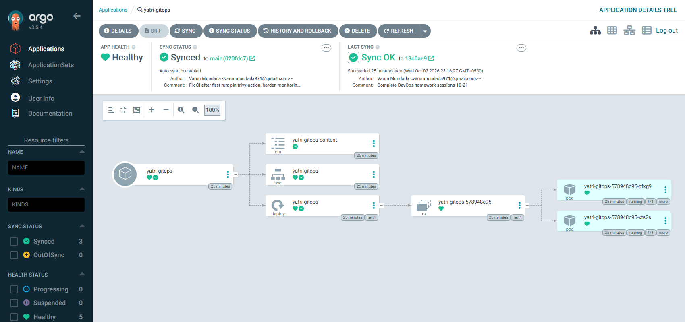

# GitOps and monitoring lab

This project brings together Kubernetes monitoring and GitOps in one small lab. It shows how a workload can be observed in real time, how alerts fire and resolve, and how Git-driven deployment can keep a cluster aligned to the repository.

## What this lab demonstrates

- Prometheus scraping app metrics and Kubernetes targets
- Grafana dashboards for live health and traffic visibility
- Alertmanager routing active and resolved alerts
- CPU, memory, latency, readiness, and error-rate monitoring
- Argo CD reconciling Git changes into the cluster

## Quick setup

```bash
minikube image load metrics-app:1.0.0
kubectl apply -f k8s/00-namespace.yaml
kubectl -n monitoring create secret generic grafana-admin --from-literal=password=<choose one>
kubectl apply -f k8s/
kubectl -n monitoring port-forward svc/grafana 3000:3000
kubectl -n monitoring port-forward svc/prometheus 9090:9090
```

## Short summary

An instrumented app generated a mix of normal traffic, CPU-heavy `/work` requests, and failing `/error` requests. Prometheus collected metrics and discovered targets via annotations, while kube-state-metrics and cAdvisor showed pod resource usage. Alertmanager tracked firing and resolved states, and Grafana displayed the final dashboard. Separately, the GitOps part showed Argo CD pulling configuration from Git and syncing the Git state into the cluster.

## Screenshot evidence

### Grafana dashboard


### Prometheus targets


### Prometheus alerts


### Alertmanager alerts


### Request rate by route and status


### Monitoring setup


### Observability view


### Cluster status


### Argo CD GitOps flow



### GitOps deployment status


## Notes

- This lab is intended for learning and hands-on testing on a small cluster.
- Alert thresholds and resource limits should be reviewed before using the setup in production.
- The main lesson is that observability and GitOps work best together: you can see system health clearly and keep the cluster state aligned with Git.
