**Presentation:** [PPT](PPT.pdf) · **Demo video:** [Video](video.mov)

# TaskBoard — DevOps Capstone

TaskBoard is a small task-management application used to demonstrate a complete DevOps delivery workflow: a React frontend, FastAPI backend, PostgreSQL database, Docker images, CI/CD, image scanning, Terraform, Kubernetes, Helm, Ingress, autoscaling, and monitoring.

## Run locally

```bash
docker compose up --build
```

Open the application at <http://localhost:3000>. The API is available at <http://localhost:8000>, Swagger UI at <http://localhost:8000/docs>, the health endpoint at <http://localhost:8000/health>, and Prometheus metrics at <http://localhost:8000/metrics>.

Run the backend tests before building or publishing images:

```bash
cd backend
pytest -q
```

## Final demo

Use this order for the final presentation. Each step explains what to demonstrate and links to the supporting evidence stored in [`screenshots/`](screenshots/). Screenshots that show an unhealthy cluster state are retained deliberately: they are evidence for the troubleshooting portion of the demo, not a success claim.

### 1. Application

Open TaskBoard at <http://localhost:3000>, select **New task**, and create a task such as `Prepare final demo`. Confirm that it appears in the task list and changes the dashboard counters.

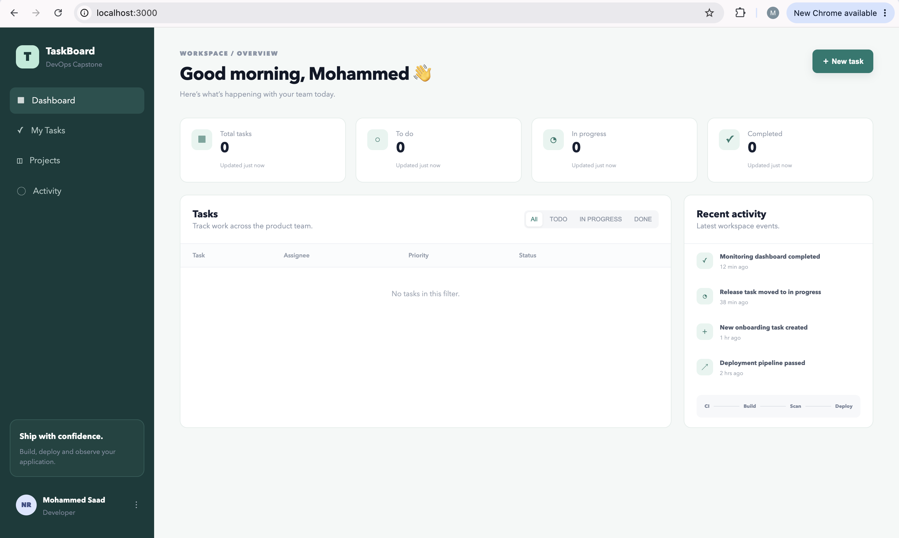

The dashboard capture shows the running React application and its task summary view.

### 2. API

Open FastAPI Swagger at <http://localhost:8000/docs>. Use `POST /api/tasks`, `GET /api/tasks`, `PUT /api/tasks/{task_id}`, and `DELETE /api/tasks/{task_id}` to create, read, update, and delete the task created in the UI.

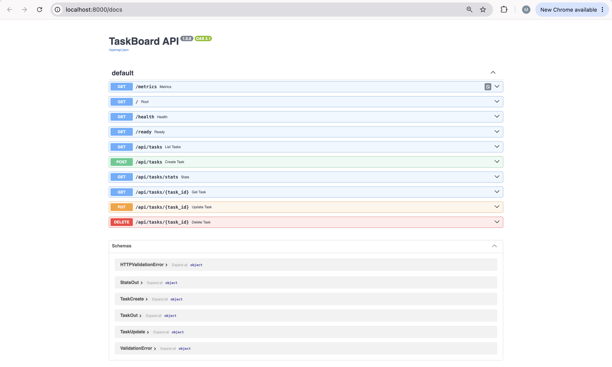

Swagger documents the CRUD endpoints, health/readiness endpoints, statistics endpoint, and metrics endpoint in one place.

### 3. Database

Show the persisted PostgreSQL rows after creating a task:

```bash
docker compose exec postgres psql -U taskboard -d taskboard -c 'SELECT id, title, priority, status, assignee, created_at FROM tasks;'
```

Explain that Alembic owns the `tasks` schema and the backend runs `alembic upgrade head` before starting. This makes the database state reproducible rather than manually created.

### 4. Git

Make a small, visible application change (for example, edit a dashboard label), then commit it with a meaningful message:

```bash
git status
git add frontend/src/main.jsx
git commit -m "chore: refine TaskBoard dashboard label"
git log --oneline -10
```

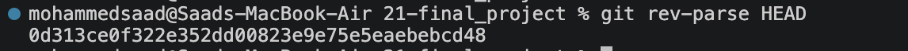

The commit SHA is the immutable identifier that should be used for CI image tags instead of relying only on `latest`.

### 5. CI

Push the commit to GitHub and open the GitHub Actions run. Show the test job first, then the frontend build, image build, security scan, and registry publish steps. The key quality gate is that a failing `pytest` job stops the pipeline before a broken image is promoted.

```bash
git push origin main
```

No GitHub Actions browser capture is stored in this repository; open the live workflow run during the presentation so its status and commit are current.

### 6. Docker

Build and run the complete stack with Docker Compose. Then show the separate backend and frontend image builds.

```bash
docker compose up --build
docker build -t taskboard-backend:local ./backend
docker build -t taskboard-frontend:local ./frontend
docker images | grep taskboard
```

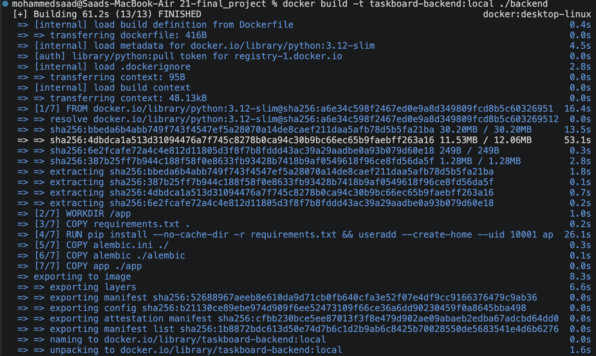

The backend image installs its Python dependencies, copies the Alembic migration and application code, and runs as an application user.

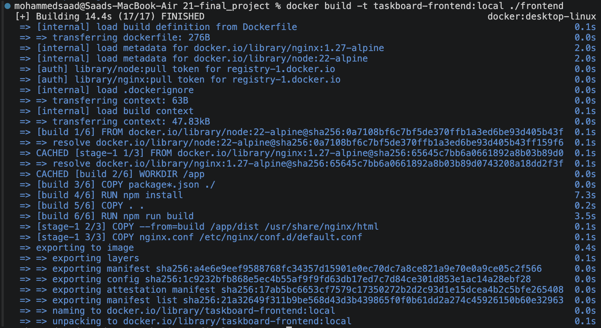

The frontend image uses a Node build stage and a compact Nginx runtime stage.

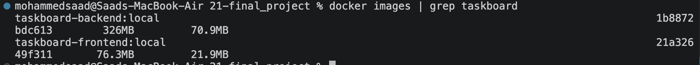

This output confirms that `taskboard-backend:local` and `taskboard-frontend:local` were produced.

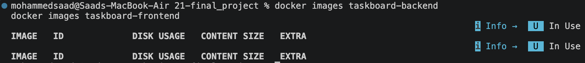

This earlier terminal capture is retained as part of the raw demo evidence; use the successful image listing above for the final walkthrough.

### 7. Security

Scan both images with Trivy, focusing on HIGH and CRITICAL findings:

```bash
trivy image --severity HIGH,CRITICAL taskboard-backend:local
trivy image --severity HIGH,CRITICAL taskboard-frontend:local
```

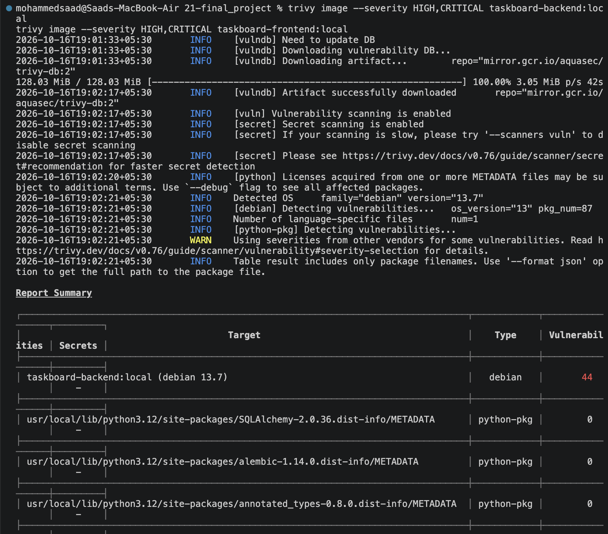

The captured report shows that Trivy scanned the image OS and Python packages. Treat reported HIGH/CRITICAL findings as remediation work: update the base image or affected package, rebuild, and scan again. A scan is valuable because it reports risk; it is not automatically a clean result.

### 8. Registry

Open the GitHub Container Registry (GHCR) package pages after the CI run. Verify both backend and frontend packages, and show tags based on the commit SHA from step 4.

```text
ghcr.io/<github-owner>/taskboard-backend:<commit-sha>
ghcr.io/<github-owner>/taskboard-frontend:<commit-sha>
```

No GHCR browser screenshot is stored locally; use the live package pages so the tag and publish time match the workflow run.

### 9. Terraform

Show the AWS infrastructure code in [`terraform/`](terraform/), then validate and plan it. Do not place credentials in the repository.

```bash
cd terraform
terraform init
terraform fmt -recursive
terraform validate
terraform plan
```

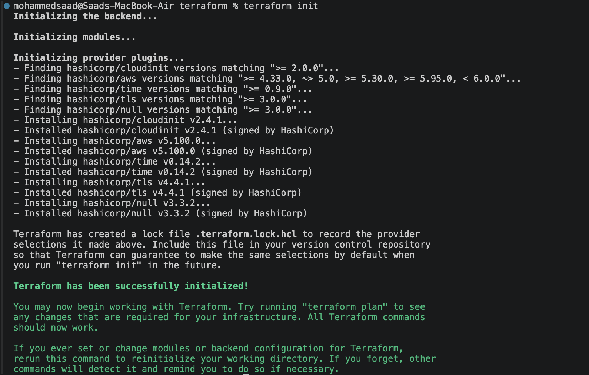

The initialization output shows the required providers and modules were resolved.

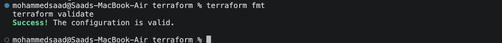

This confirms that the Terraform configuration is syntactically valid before any AWS resources are changed.

### 10. Kubernetes

Deploy the chart to the `taskboard` namespace, then show the workload and service state:

```bash
kubectl get pods -n taskboard
kubectl get svc -n taskboard
kubectl get endpoints -n taskboard
```

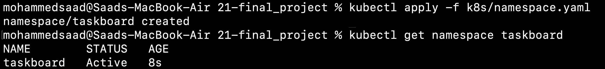

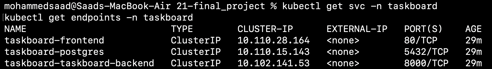

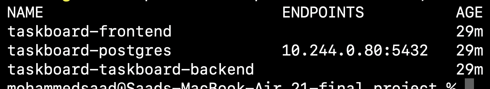

The services expose frontend on port 80, PostgreSQL on 5432, and the backend on 8000 inside the cluster.

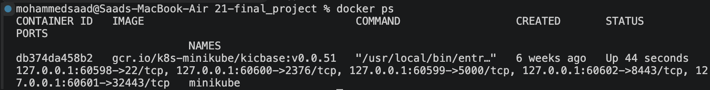

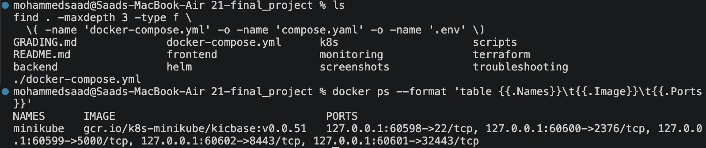

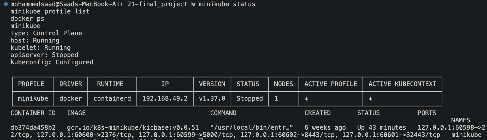

These three captures document an earlier local-cluster state. If the API server is stopped, recover the cluster before claiming the pods are ready:

```bash
minikube start
kubectl get nodes
kubectl get pods -n taskboard
```

### 11. Helm

Render the chart before installing it, then show the release:

```bash
helm template taskboard helm/taskboard
helm upgrade --install taskboard helm/taskboard -n taskboard --create-namespace
helm list -n taskboard
```

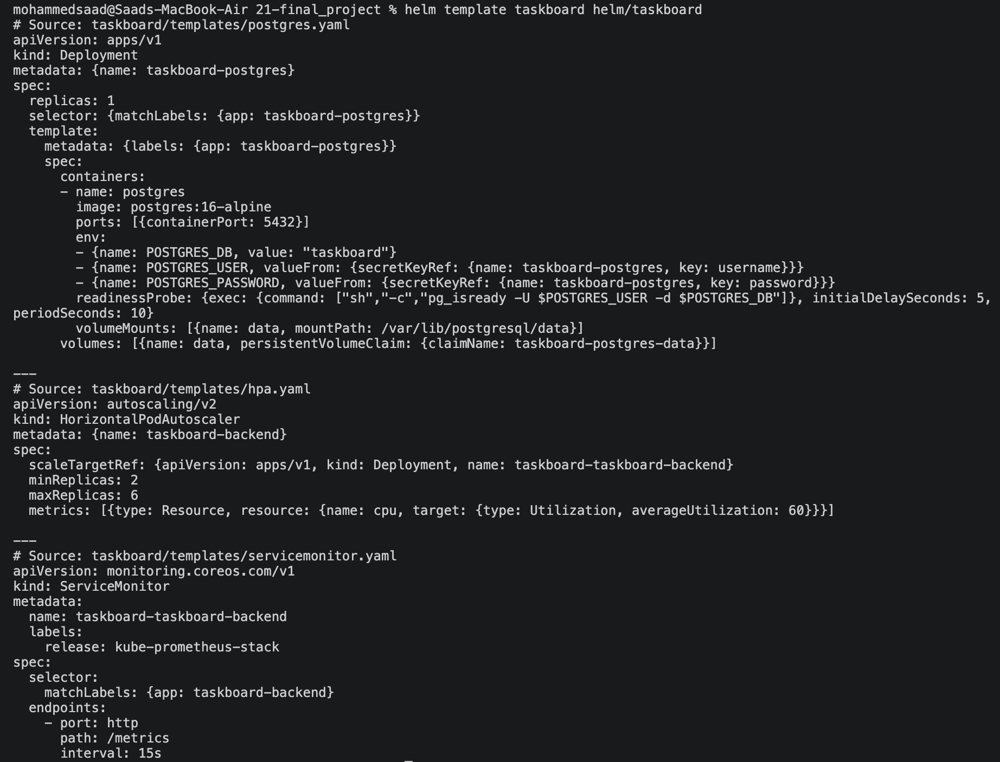

The rendered output includes the PostgreSQL Deployment, HorizontalPodAutoscaler, and ServiceMonitor. Use `helm list -n taskboard` live to show the installed release and revision.

### 12. Ingress

Enable the ingress controller, deploy the Ingress, add the host mapping required by the local cluster, and open the application through the configured hostname.

```bash
minikube addons enable ingress
kubectl get ingress -n taskboard
minikube ip
```

For a local host such as `taskboard.local`, add the reported Minikube IP to `/etc/hosts`, then browse to `http://taskboard.local`.

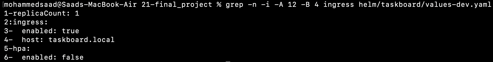

The development values enable Ingress with the `taskboard.local` hostname.

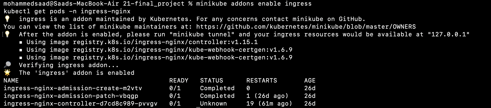

This capture records an unhealthy controller (`0/1` and `Unknown`). It belongs to the failure/troubleshooting evidence; wait for the controller to be Ready before demonstrating the hostname.

### 13. HPA

Show autoscaling settings and status:

```bash
kubectl get hpa -n taskboard
kubectl describe hpa taskboard-backend -n taskboard
```

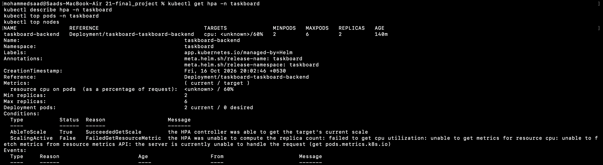

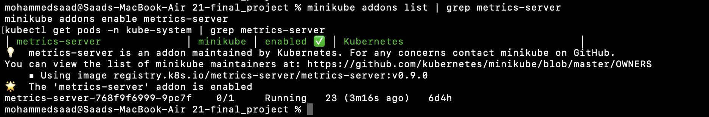

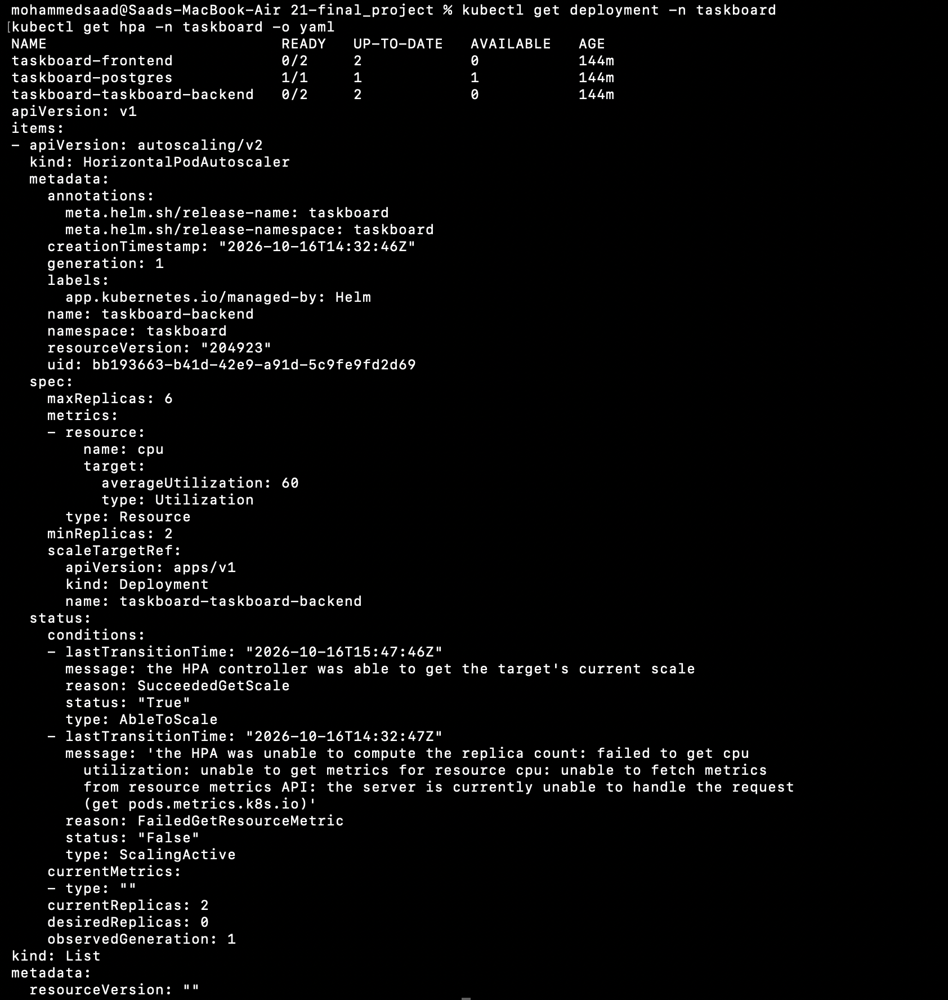

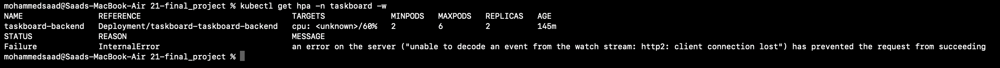

These captures show the exact failure mode to explain: the HPA could read its target scale but could not fetch CPU metrics from the resource metrics API. Recover the Metrics Server and wait for it to become Ready before expecting a CPU target value:

```bash
minikube addons enable metrics-server
kubectl get pods -n kube-system | grep metrics-server
kubectl top pods -n taskboard
```

### 14. Monitoring

First show the application metrics endpoint, then Prometheus and Grafana.

```bash
curl http://localhost:8000/metrics
kubectl port-forward -n monitoring svc/prometheus 9090:9090
```

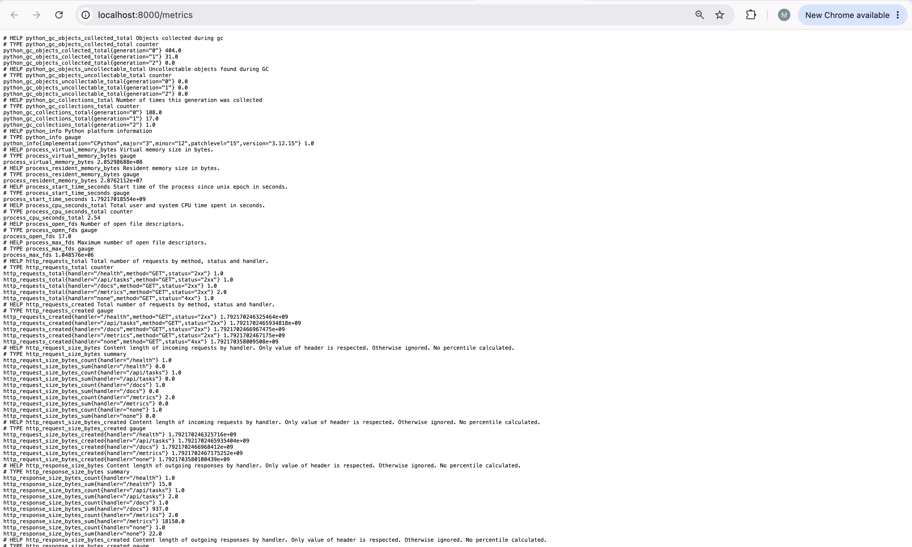

The backend exports standard process metrics and HTTP request counters, including `http_requests_total`.

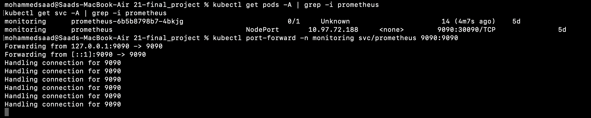


The Prometheus query view proves Prometheus itself is reachable. During the live demo, show the **Targets** page and confirm the TaskBoard scrape target is `UP`; then open Grafana and show a panel using TaskBoard HTTP metrics. The captured `up` query also records failed infrastructure targets, so it should be explained as diagnostic evidence rather than presented as all targets healthy.

### 15. Failure simulation

Apply one deliberate failure, inspect it, explain the cause, and remove or repair it. The repository includes manifests for a broken image and a broken Service in [`troubleshooting/`](troubleshooting/).

```bash
kubectl apply -f troubleshooting/broken-image.yaml
kubectl get pods -n taskboard
kubectl describe pod -n taskboard <broken-pod-name>
kubectl delete -f troubleshooting/broken-image.yaml
```

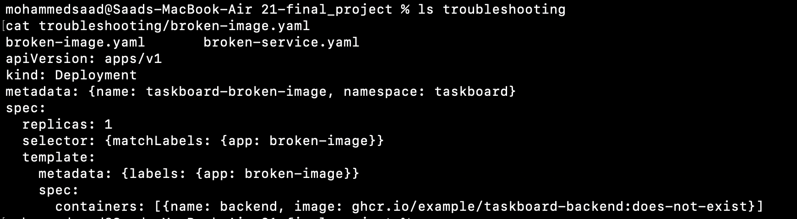

The manifest intentionally references a nonexistent image tag. It should produce an image-pull failure, which demonstrates a practical diagnosis flow using `kubectl get pods`, `kubectl describe pod`, events, and manifest review.
